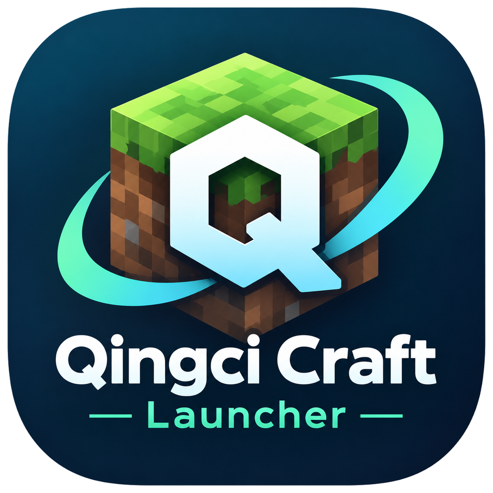

<p align="center">
  
</p>

# Qingci Craft Launcher

[中文](README.md) | **English**

[](https://github.com/luoqingciya/Qingci-Craft-Launcher/actions/workflows/ci-main.yml)
[](LICENSE)

A cross-platform, lightweight Minecraft: Java Edition launcher built with **Tauri 2 + Rust**.

> Status: **it installs, launches, manages mods and updates itself.** The full path for vanilla
> versions (26.3, plus older releases such as 1.7.10 with the legacy asset layout) works end to end:
> fetch manifest → download ~598 MB → pick Java → assemble command → launch → stream logs → stop.
> Fabric, Forge and NeoForge are selectable per version (Forge installs through our own
> processor pipeline rather than the official installer); the mods tab supports search, install
> (required dependencies pulled in automatically), removal and update checks. Installed projects
> are marked, the dependencies to be pulled in are visible before installing, and update checks
> also report mods with no build for the current version. The log panel filters by level, searches,
> and copies.
> Abnormal exits produce a crash summary that also reads the game's own `crash-reports/`.
> Installed builds update in place: check, download, verify the signature, install silently,
> relaunch.
> Roadmap: [docs/DEVELOPMENT_PLAN.md](docs/DEVELOPMENT_PLAN.md) · Changes: [CHANGELOG.md](CHANGELOG.md).

## Feature status

| Capability | Status | Notes |
|---|---|---|
| Version manifest | ✅ | Derived from Mojang's official `version.json`; no hardcoded version list |
| Install & verify | ✅ | Version files, libraries, assets, natives; SHA-1 verified per file |
| Java selection | ✅ | Picks by version requirement; manual override is validated, not trusted blindly |
| Launch & logs | ✅ | Streams stdout/stderr live; "Stop" really terminates the process |
| Settings | ✅ | Game directory, offline player name, max heap, Java runtime, download source |
| Loaders | ✅ | Fabric / Forge / NeoForge; Forge installs through our own processor pipeline instead of the official installer. Forge 1.16.5, 1.20.1 and NeoForge 21.1.72 verified into the main menu |
| Mod management | ✅ | Modrinth search / install / remove / update check; required dependencies installed automatically and previewable before install |
| Mod status | ✅ | Installed projects are marked; update checks also report mods incompatible with the current version |
| Chinese names & filters | ✅ | Name database fetched from a registry and cached at startup; Chinese keyword aliases; 19 localised categories |
| Log tools | ✅ | Filter by level, search, one-click copy (copies the filtered lines) |
| Crash summary | ✅ | Non-zero exit produces a verdict; reads `crash-reports/` when present |
| Auto-update | ✅ | Installed builds check automatically; nothing installs without a valid signature |
| Microsoft login | ✅ | Device code flow (the launcher never sees the password); tokens live in the OS keychain and refresh silently at startup |
| Instances | ✅ | Multiple independent game directories, each with its own version selection; the launch panel opens the directory and shows the installed mod count |
| Runtime info | ✅ | The about tab shows version, OS/arch, Tauri and WebView, copyable as a bug-report block |

## Design principles

- **Lightweight**: uses the system WebView. Portable executable is 12.7 MB, NSIS installer 3.8 MB.
- **Cross-platform**: Windows 10+ / macOS 12+ / Linux (glibc 2.31+); CI builds and tests on all three.
  Published artifacts cover Windows, macOS and Linux.
- **Testable**: core logic (version parsing, rule evaluation, argument assembly, auth protocols, mod
  resolution, crash report parsing) lives in GUI-free Rust crates — 380 Rust tests + 184 frontend
  tests in CI.
- **Manifest-driven**: versions, libraries and JVM arguments are all derived from official manifests; no version list is hardcoded.

## Tech stack

| Layer | Choice |
|---|---|
| App framework | Tauri 2.12 (Rust 1.99.1 / edition 2024, MSRV 1.90) |
| Frontend | React 19 + TypeScript 7 + Vite 8 + Tailwind CSS 4 |
| Async & network | tokio + reqwest (rustls) |
| Frontend quality | vitest + Testing Library; oxlint (not eslint — see below) |
| Update delivery | `tauri-plugin-updater` + Tencent Cloud COS (signature-verified, see [docs/RELEASE.en.md](docs/RELEASE.en.md)) |
| Credential storage | OS keychain: Windows Credential Manager / macOS Keychain / Secret Service (see [SECURITY.md](SECURITY.md)) |

> **Why oxlint instead of eslint**: `typescript-eslint` declares a peer dependency of
> `typescript <6.1.0`, while this project uses TS 7 (the native Go compiler).
> oxlint parses TypeScript itself and does not depend on the `typescript` package.

## Repository layout

```
crates/          Rust domain layer (all testable without a GUI)
  qcl-core       Version parsing, rule evaluation, launch command assembly (pure logic)
  qcl-net        Download planning, executor, HTTP download with SHA-1 verification
  qcl-install    Install orchestration: version files, assets, natives, Fabric merging,
                 and the Forge / NeoForge processor chain with `inheritsFrom` merging
  qcl-java       Java detection and on-demand installation
  qcl-runtime    Game process launch, log forwarding, termination, crash-report parsing
  qcl-platform   Host platform probing (OS version determines GC flags)
  qcl-auth       Microsoft device-code login and Xbox auth chain (no token persistence)
  qcl-mods       Modrinth search/install/remove/update, dependency resolution, Chinese name data
  qcl-cli        Headless entry point (smoke tests and debugging)
src-tauri/       Tauri app layer (thin adapter: IPC and state only)
src/             React 19 frontend
docs/            Development plan, release guide and architecture decision records
assets/          Brand assets (icon sources, mod name database)
```

## Installation

Download from [Releases](https://github.com/luoqingciya/Qingci-Craft-Launcher/releases):

| Platform | File | Size | Notes |
|---|---|---|---|
| Windows | `QingciCraftLauncher_*_x64-setup.exe` | 3.8 MB | NSIS installer; installs per-user, no admin rights; supports auto-update |
| Windows | `QingciCraftLauncher_*_x64-portable.exe` | 12.7 MB | No install, double-click to run; game directory sits next to the exe; **no auto-update** |
| macOS | `QingciCraftLauncher_*_universal.dmg` | 12.1 MB | Universal binary, runs on Intel and Apple Silicon; **unsigned**, first launch needs right-click → Open |
| Linux | `QingciCraftLauncher_*_amd64.deb` | 5.3 MB | Debian / Ubuntu package; depends on the system webkit2gtk |
| Linux | `QingciCraftLauncher_*_x86_64.AppImage` | 83.5 MB | No install; self-contained runtime |

The macOS and Linux artifacts and the Windows portable build are **GitHub Releases only** and take no
part in auto-update — the update server carries just the Windows installer.

### First launch on macOS

The app inside the dmg is **not signed and not notarized** — that needs a paid Apple Developer
account. macOS therefore refuses a plain double-click with "cannot verify the developer". Pick one:

1. **Right-click the app → Open**, then click "Open" in the dialog (once only)
2. System Settings → Privacy & Security → the blocked item appears at the bottom → "Open Anyway"
3. Terminal: `xattr -dr com.apple.quarantine "/Applications/Qingci Craft Launcher.app"`

The third is the least obvious and the most effective — **there is no other way** short of paying for
signing and notarization. That is the cost of unsigned distribution, not a defect of this release.

Where you put it does not matter, but **avoid read-only locations**: the game directory follows the
app by default, and falls back to `~/Library/Application Support/cn.luoqingciya.qcl/` when the
location is not writable (the UI says why).

The size gap comes from **how much of the WebView is reused**: Windows uses the bundled WebView2
runtime, the deb relies on `libwebkit2gtk-4.1` from the distribution, while an AppImage has to carry
the entire WebKitGTK + JavaScriptCore + GTK3 stack to run on any distribution — that stack alone is
over 70 MB. Pick the deb if size matters, the AppImage if you want "download and double-click".

Sizes are measured from the current release and drift a little between versions.

**The download source is switchable**: Settings offers Mojang's official endpoints (default) or the
[BMCLAPI](https://bmclapidoc.bangbang93.com/) mirror. A failing mirror — or a file that fails
verification — **falls back to official automatically**; it is a faster path, not a single point of
failure. When the mirror is in use the UI credits it, which BMCLAPI's terms also require.

The default game directory is **`game/` inside the install directory** (portable layout:
copy the whole folder and your worlds move with it). If that location is not writable,
the launcher falls back to the app data directory and explains why in the UI.

**Multiple game directories ("instances") are supported.** Settings can create, rename and remove
them; each has its own directory and its own version selection — vanilla in one, a modpack in another,
switching does not disturb the other. Once there is more than one, the launch panel grows a switcher.
New instances land in `instances/<name>` by default, or you can point them anywhere.
**Removing an instance only drops the record — files on disk are never deleted.**

**The installed build and the portable build keep separate settings.** The installed one uses
`%APPDATA%\cn.luoqingciya.qcl\`; the portable one writes `settings.json` next to the exe. They share
the same application identifier, and used to share a single config file — which meant a version
picked in one showed up in the other. That is no longer the case.

**Only one launcher window may run at a time**: double-clicking again focuses the existing window
instead of opening a second one. Note that the installed and portable builds share the application
identifier, so they exclude each other too — double-clicking the portable build while the installed one
is running just brings the installed window forward.

### Auto-update

An installed build checks for updates at startup and stays silent when there is none. When a newer
version exists, the About page shows it with its release notes; "Download and install" then:

1. downloads the package from COS,
2. **verifies a minisign signature against a public key compiled into the binary** — a mismatch
   aborts the install,
3. installs silently and relaunches.

Portable builds have no uninstaller, and Windows will not let a running exe replace itself, so they
are pointed at the download page instead.

Setup and key management: [docs/RELEASE.en.md](docs/RELEASE.en.md).

## Mod loaders

Once a game version is selected, pick a loader in the same dialog: **Fabric / Forge / NeoForge**
(Quilt is not supported yet). Available loader versions are fetched live from upstream manifests;
nothing is hardcoded.

- **Fabric** only needs a profile merge, so installing takes a second.
- **Forge / NeoForge** actually run the install steps (splitting the vanilla jar, merging mappings,
  applying binary patches) — 20–60 seconds, with a "installing loader 3/6" step indicator.
  Every step runs locally; the one that may need the network (Mojang mappings) goes through the
  configured download source, **never to Mojang's own hosts**.
- Installing a loader needs a **Java 8+** runtime (independent of the Java the game itself requires);
  the launcher picks one automatically.
- Each "game version + loader version" pair gets its own version directory, so installing another
  loader version never overwrites an existing one.

> Installing a loader is not the same as the game running: Forge / NeoForge are stricter about the
> Java version than vanilla. Forge on 1.20.1, for example, cannot run on Java 26 (its ASM is too old)
> and needs the Java that version targets.

## Development

Requirements:

- Rust **1.99.1** (pinned by `rust-toolchain.toml`; `rustup` installs it automatically)
- Node.js ≥ 22 and pnpm ≥ 10
- Windows: MSVC Build Tools. Linux: `libwebkit2gtk-4.1-dev` and friends (see CI config)

Common commands:

```bash
# Rust
cargo fmt --all --check
cargo clippy --workspace --all-targets -- -D warnings
cargo test --workspace --all-features

# Frontend (lint + unit tests + type check + production build)
pnpm install
pnpm lint
pnpm test
pnpm build

# Desktop app (dev mode with hot reload)
pnpm tauri dev

# Package installers
pnpm tauri build              # produces both NSIS and MSI
pnpm tauri build --bundles nsis

# Headless entry point: install and print the launch command without starting the game
cargo run -p qcl-cli -- 26.3 --dry-run
```

## Contributing

This project uses a strict PR workflow: every change (including docs) goes through
branch → PR → green CI → review → squash merge.
See [CONTRIBUTING.en.md](CONTRIBUTING.en.md) ([中文](CONTRIBUTING.md)).

Release and auto-update setup, key management and troubleshooting:
[docs/RELEASE.en.md](docs/RELEASE.en.md) ([中文](docs/RELEASE.md)).

## Disclaimer

This is an unofficial launcher, not affiliated with Mojang Studios or Microsoft.
"Minecraft" is a trademark of Mojang Studios. This project does not distribute any game
files, libraries or assets — everything is fetched at runtime from official public endpoints.
It does not and will not provide any way to bypass authentication.

## License

[GPL-3.0](LICENSE) with **additional terms under GPLv3 Section 7**
([English](ADDITIONAL-TERMS.en.md) · [中文](ADDITIONAL-TERMS.md)):

- Copyright and license notices must be preserved when distributing
- **Modified versions must be renamed**; they must not imply they are the original or endorsed by the author

Verbatim copies of the unmodified work may keep the original name — the additional terms
do not restrict verbatim redistribution, which GPLv3 permits.
